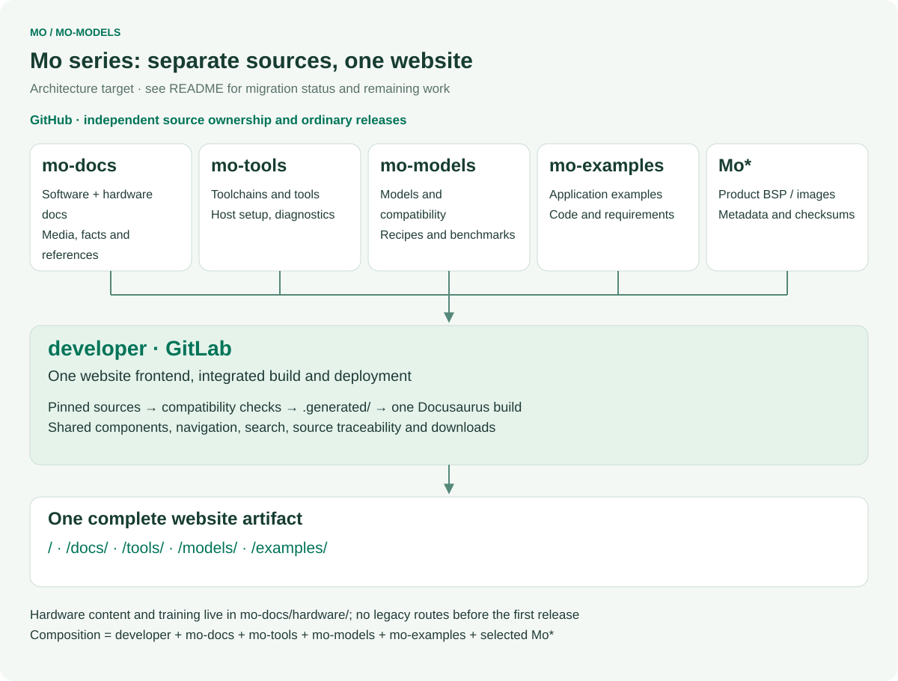
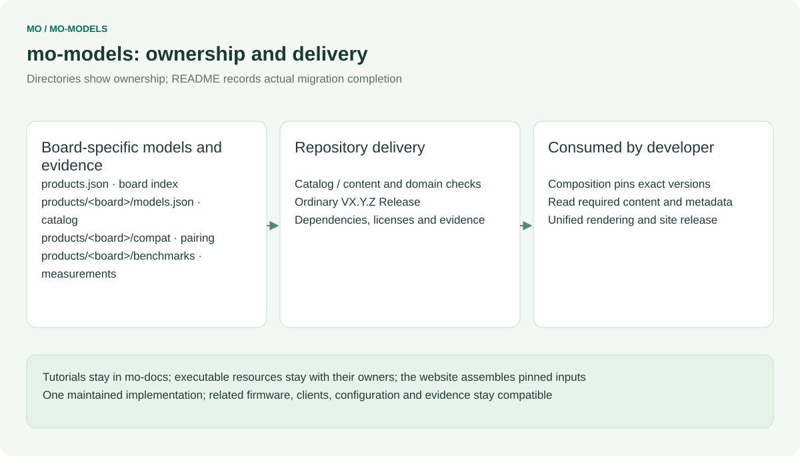
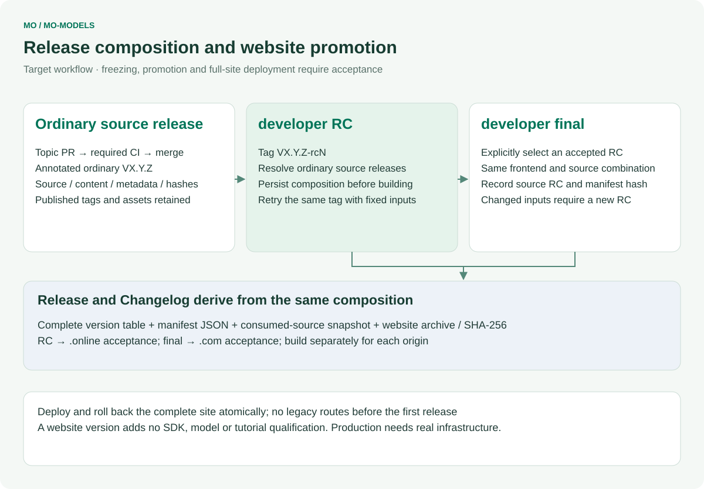

# mo-models

English | [简体中文](README.zh-CN.md)

AI model catalog, compilation scripts and reproducible benchmark scripts for InHand Mo series single-board computers.

This repository will hold the catalog of AI models validated on Mo boards, the scripts that compile models for the on-board NPU (TI C7x with TIDL), reproducible benchmark scripts, and the compatibility matrix between model, runtime and image versions.

Related repositories:

- [Mo62A](https://github.com/inhandnet/Mo62A) — board support package, OS image build and device-side runtime for the Mo 62A board.
- [mo-docs](https://github.com/inhandnet/mo-docs) — product documentation for the Mo series.

## Mo series repository architecture

[](architecture/repository-map.en.svg)

<table width="100%">
  <thead>
    <tr>
      <th width="171" align="left">Repository</th>
      <th width="398" align="left">Maintained source</th>
      <th width="379" align="left">Delivery responsibility</th>
    </tr>
  </thead>
  <tbody>
    <tr>
      <td align="left"><strong>developer</strong> · GitLab</td>
      <td align="left">Website components, routes, search, integration and contracts</td>
      <td align="left">The complete website, release composition and deployment</td>
    </tr>
    <tr>
      <td align="left"><a href="https://github.com/inhandnet/mo-docs">mo-docs</a></td>
      <td align="left">Software/hardware tutorials, specifications, media, design files and training</td>
      <td align="left">Versioned content and reference assets</td>
    </tr>
    <tr>
      <td align="left"><a href="https://github.com/inhandnet/mo-tools">mo-tools</a></td>
      <td align="left">Toolchain/SDK selection, environment setup, reusable tools and Studio</td>
      <td align="left">Tool metadata and source packages</td>
    </tr>
    <tr>
      <td align="left"><a href="https://github.com/inhandnet/mo-models">mo-models</a></td>
      <td align="left">Model catalog, compilation resources, compatibility and raw benchmarks</td>
      <td align="left">Model references, evidence and artifact status</td>
    </tr>
    <tr>
      <td align="left"><a href="https://github.com/inhandnet/mo-examples">mo-examples</a></td>
      <td align="left">Complete examples with related firmware, clients and configuration</td>
      <td align="left">Example sources and their requirements</td>
    </tr>
    <tr>
      <td align="left"><strong>Mo*</strong> · product repositories</td>
      <td align="left">Each product&#x27;s BSP, drivers, root filesystem, image build and flashing</td>
      <td align="left">Product images and checksummed release metadata</td>
    </tr>
  </tbody>
</table>

`Mo*` covers independently maintained product repositories such as [Mo62A](https://github.com/inhandnet/Mo62A), Mo68A, Mo69A, Mo67A, Mo3588 and Mo3568. The framework does not fix their number. Hardware content and maintainer training live in mo-docs; the archived mo-hardware repository is only a migration record, and the pre-release website keeps no legacy `/hardware-docs/` routes.

Each source repository publishes ordinary versions. Developer alone has website RC/final channels. The target composition binds **developer + mo-docs + mo-tools + mo-models + mo-examples + selected Mo\*** to exact commits and consumed-asset hashes. A new source release does not change an already frozen website combination. Tutorial applicability, PCB revisions, image versions and actual validation remain distinct.

## Repository ownership

[](architecture/ownership.en.svg)

## Status

The first catalog is in place: 12 entries in `products/mo62a/models.json` (11 bundles shipped in Mo OS V1.1.0 plus the tutorial model), the compile and benchmark scripts published by the documentation, and the V1.1.0 compatibility baseline. Following the TI edgeai-modelzoo convention, model files are referenced through `.link` files (one URL per file) and never stored here; the source models and TI pre-compiled artifacts link to TI's public model zoo. InHand-compiled bundles have no download server yet, so their status is `pending-hosting`. Catalog publication does not establish new hardware verification or model hosting.

## Repository layout

Product directories: `products.json` lists the boards; each board keeps its own content under `products/<board>/` (`products/mo62a/` for Mo62A, `products/mo68a/` reserved for Mo68A). Boards do not share files; catalog paths are relative to the product directory.

<table width="100%">
  <thead>
    <tr>
      <th width="284" align="left">Path</th>
      <th width="664" align="left">Purpose</th>
    </tr>
  </thead>
  <tbody>
    <tr>
      <td align="left"><code>products/mo62a/models/</code></td>
      <td align="left">One directory per model: README, <code>source-model.link</code>, <code>ti-artifact-am62a.link</code>.</td>
    </tr>
    <tr>
      <td align="left"><code>products/mo62a/compile/</code></td>
      <td align="left">Host-side compilation scripts (TIDL <code>11_02_17_00</code>, pinned in mo-tools).</td>
    </tr>
    <tr>
      <td align="left"><code>products/mo62a/benchmarks/</code></td>
      <td align="left">On-device latency script and raw result records.</td>
    </tr>
    <tr>
      <td align="left"><code>products/mo62a/compat/</code></td>
      <td align="left">Tested board / image / TIDL / runtime baselines (<code>compat.json</code>).</td>
    </tr>
    <tr>
      <td align="left"><code>products/mo62a/models.json</code></td>
      <td align="left">Machine-readable catalog (schema 2); validated by <code>scripts/validate-catalog.py</code> in CI.</td>
    </tr>
    <tr>
      <td align="left"><code>scripts/</code></td>
      <td align="left">Repository maintenance scripts (commit message check, changelog generation).</td>
    </tr>
    <tr>
      <td align="left"><code>.githooks/</code></td>
      <td align="left">Git hooks that run the commit message check locally.</td>
    </tr>
    <tr>
      <td align="left"><code>.github/</code></td>
      <td align="left">Issue forms, pull request template and GitHub Actions workflows.</td>
    </tr>
    <tr>
      <td align="left"><code>release-notes/</code></td>
      <td align="left">Changelog baseline used by the release workflow.</td>
    </tr>
  </tbody>
</table>

## Contributing

Contributions are welcome through pull requests to `master`. Read [CONTRIBUTING.md](CONTRIBUTING.md) for the commit message convention, the pull request process and how to enable the local Git hooks:

```bash
git config core.hooksPath .githooks
```

Every pull request must pass the `commit-message` and `ci` checks before it can be merged. Use GitHub issues for bugs, reproducible problems and feature requests in this repository.

## Releases and tags

[](architecture/release-flow.en.svg)

New releases use annotated ordinary `V<major>.<minor>.<patch>` tags on checked `master` commits. Only developer publishes website release candidates. The release workflow validates catalogs, packages source with SPDX SBOM, records the source commit and catalog hashes in `release.json`, writes SHA-256 checksums, then publishes a complete GitHub Release. Historical RCs remain unchanged. Changelog headings are bilingual; entries retain their English commit summaries.

```bash
git switch master
git pull --ff-only
git tag -a V1.0.0 -m "V1.0.0"
git push origin V1.0.0
```

## Security

Do not report security vulnerabilities in public issues. Follow [SECURITY.md](SECURITY.md).

## License

This repository is licensed under the terms in [LICENSE](LICENSE). Third-party content added later keeps its own license, stated next to the content.

## Unified website integration

`products/mo62a/models.json` and `products/mo62a/compat/compat.json` own model inventory, source references, compatibility and measured evidence. `pending-hosting`, `inventory`, `tutorial` and `audited-latency` remain distinct. Developer reads a pinned source revision, validates the combined data, and renders the website; this repository has no documentation-site frontend or website deployment.

Run `node scripts/check-catalog.mjs` and `node --test tests/*.test.mjs` with Node 22. `validation/` is exported from a committed developer contract and checked by hash; do not edit it locally. For integrated preview, run developer's `npm run preview -- --source mo-models=/path/to/mo-models`.

Diagrams are generated centrally by developer/scripts/render-architecture.mjs. Regenerate all repository diagrams after changing the common architecture. Diagrams show ownership; the status section and catalog define currently available content and verification.

Regenerate these diagrams from developer with `node scripts/render-architecture.mjs --repo mo-models --out /path/to/mo-models/architecture`. Source releases validate the catalogs and resources; developer separately verifies the combined website release and deployment. Open each diagram to read the original SVG.

## Tutorial model and evidence ownership

[products/mo62a/compile/zone-demo](products/mo62a/compile/zone-demo/README.md) owns model fetching, compilation, inspection and the `model.py` interface. Mo-examples generates its interface copy from a pinned commit and hash. Raw benchmarks live in `products/mo62a/benchmarks/results/`; runtime-stack and TI-binary comparison evidence lives in [products/mo62a/compat/evidence](products/mo62a/compat/evidence/MIGRATION.md). Migration retains provenance, original hashes and licenses.
